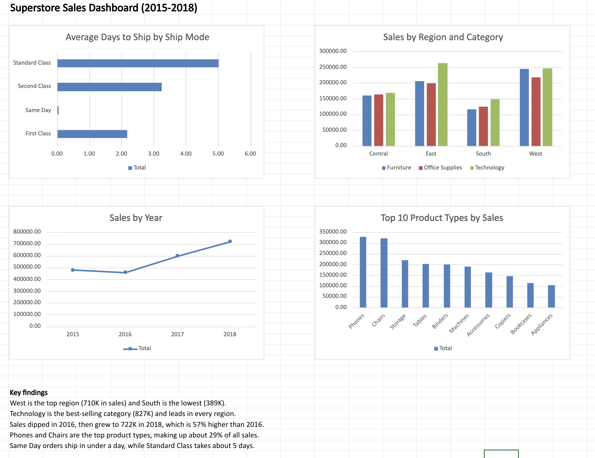

# Superstore Sales Dashboard (2015-2018)

An Excel dashboard that answers four questions about a retail store's sales.

## Questions I asked
1. Where do sales come from (by region and category)?
2. How have sales changed over time?
3. Which product types sell the most?
4. How fast do orders ship?

## Key findings
- West is the top region (710K in sales) and South is the lowest (389K).
- Technology is the best-selling category (827K) and leads in every region.
- Sales dipped in 2016, then grew to 722K in 2018, which is 57% higher than 2016.
- Phones and Chairs are the top product types, making up about 29% of all sales. The top 10 product types make up about 88%.
- Same Day orders ship in under a day, First Class takes about 2.2 days, Second Class 3.2 days and Standard Class 5.0 days.

## Data
Kaggle "Superstore Sales Dataset" by Rohit Sahoo: 9,800 rows and 18 columns of orders from 2015 to 2018. It has no Profit column, so all analysis is based on Sales.

## How I cleaned the data
- The dates in the file are day/month/year, but Excel read many of them as month/day/year. I reloaded the file in Python (pandas, in Google Colab) with the correct date format.
- Removed 1 duplicate row (9,800 to 9,799 rows).
- 11 Postal Codes are blank (all Burlington, Vermont). I left them because I did not use Postal Code.
- Added Year, Month and Days to Ship columns, and formatted Sales to 2 decimals.

## Tools
Python (pandas) for cleaning, Excel for pivot tables, charts and the dashboard.

## Files
- **superstore-dashboard.xlsx**: the full workbook with the dashboard, one sheet per question, the raw data and a cleaning log.
- **dashboard.png**: a picture of the dashboard.
